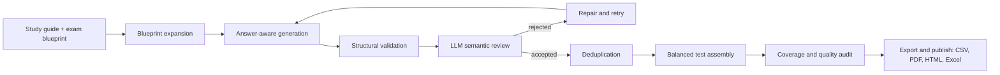

# AI Certification Mock Test Generator

An LLM-powered pipeline that turns a certification study guide into complete, exam-aligned practice tests, then validates, audits, and publishes them automatically.

> **Portfolio showcase.** This repository describes the project's design, capabilities, and results. The source code, prompts, exam configurations, and generated question banks are proprietary and are not published here. See [Intellectual property](#intellectual-property).

---

## At a glance

| Metric | Value |
| --- | --- |
| Certification exams configured | 27 |
| Exams with published mock tests | 24 |
| Vendors covered | AWS, Microsoft |
| Tests per exam | 6 full-length tests (65 or 75 questions each) |
| Practice questions published | ~9,600 |
| Cost reduction from prompt caching | ~43% per run (68% of input tokens served from cache) |

---

## The problem

Good practice exams are expensive to write by hand. A realistic set needs hundreds of questions per exam that:

- follow the official domain weighting,
- mix recall and scenario questions in the right ratio for the exam level,
- avoid repeats and give-away answer patterns,
- explain why every option is right or wrong.

New certifications are released and retired often, so manual authoring can't keep up.

## The solution

A config-driven generation pipeline. Each certification is described by:

1. **A study guide** that grounds every question in the published exam objectives.
2. **A blueprint config** that sets the domains, subtopics, question mix, and quality thresholds.

Adding a new exam means adding these two inputs. The pipeline code doesn't change.

---

## How it works

| Stage | What it does |
| --- | --- |
| Blueprint expansion | Breaks the exam into generation buckets by domain, subtopic, question style, and question type. |
| Answer-aware generation | Generates each question against a target answer key, so correct answers stay evenly spread across A–D. |
| Structural validation | Deterministic rules check format, option count, answer-key consistency, and explanation completeness. |
| LLM semantic review | A second model scores each question for grounding, clarity, difficulty, distractor quality, and answer correctness. |
| Repair and deduplication | Fixable questions are retried. Rejected stems are fed back as a forbidden list so the same duplicate isn't regenerated. |
| Test assembly | Accepted questions are distributed into tests that each match the official domain weighting. |
| Audit and publish | Coverage, answer-key balance, acceptance rate, and cost are checked against thresholds before anything is published. |

### Question design

- **Two styles:** *Direct* (knowledge recall) and *Scenario* (applied decision-making).
- **Two types:** *Single* answer and *Multi-select*, where the question states how many options to pick.
- **Level-aware mix:** Professional and Specialty exams lean toward scenario questions. Fundamentals and Associate exams lean toward direct ones.
- **Per-option explanations:** Every option comes with its own explanation of why it is correct or incorrect.

---

## Engineering highlights

**Generator and validator are separate models.** One model writes questions and a different model reviews them, so a model never grades its own output.

**Prompt caching for cost control.** Prompts put the unchanging content first (exam context, study guide, rules) and the per-question details last. The shared opening is billed at the cached-input rate, which cut run cost by about 43% in a measured run.

**Resumable, crash-safe runs.** The question bank is checkpointed as it grows, so an interrupted run picks up where it stopped. An OS-level lock allows only one run per certification, so concurrent runs can't overwrite each other's output.

**Full cost and token observability.** Every LLM call is logged with its token counts (including cached tokens) and estimated cost. Each run produces an HTML dashboard with history, per-model breakdowns, and audit warnings.

**Quality gates before publishing.** Tests are published only after an automated audit checks domain coverage, difficulty, style and type mix, answer-key distribution, and cost per question.

**Treating source content as untrusted.** Study guide text is sent to the model, so the pipeline treats embedded instructions in source documents as potential prompt injection rather than trusted input.

**Certification catalog.** A companion scraper builds a static website listing exams across eight certification providers. It tracks release and retirement dates and highlights which active exams still need a mock test.

---

## Outputs

For each certification, the pipeline produces:

- **Learner-facing mock tests** with questions, options, and per-option explanations. Internal validation metadata is removed.
- **A formatted PDF question bank.**
- **An audit dashboard** (HTML and Excel) showing coverage by domain, subtopic, difficulty, style, type, and answer key.
- **A run report** covering duration, acceptance rate, token usage, and estimated cost.

---

## Tech stack

| Area | Technologies |
| --- | --- |
| Language | Python |
| AI platform | Azure OpenAI / Microsoft Foundry |
| Reporting | HTML dashboards, Excel (openpyxl), PDF (reportlab), CSV |
| Data and web | Web scraping, static site generation |
| Practices | Config-driven design, checkpointing, file locking, cost telemetry, LLM-as-judge validation |

---

## Intellectual property

### License and copyright

Copyright © 2026 Ram P S. All rights reserved.

This repository is provided for portfolio and demonstration purposes only. No license is granted to reproduce, distribute, modify, or commercially use the documentation, diagrams, or other original materials without prior written permission.

### Not included

The following are proprietary and are **not** included or licensed for reuse:

- source code and pipeline implementation
- prompts and prompt designs
- exam blueprint configurations and quality thresholds
- generated question banks, mock tests, and reports

All questions are original content generated from publicly available exam objectives. They are not taken from real exams.

### Trademarks

AWS, Microsoft, Azure, and all certification names and exam codes are trademarks of their respective owners. This project is independent and is not affiliated with, endorsed by, or sponsored by Amazon Web Services or Microsoft.

---

## Contact

Interested in the project, a demo, or a collaboration? Contact me through my GitHub profile.
